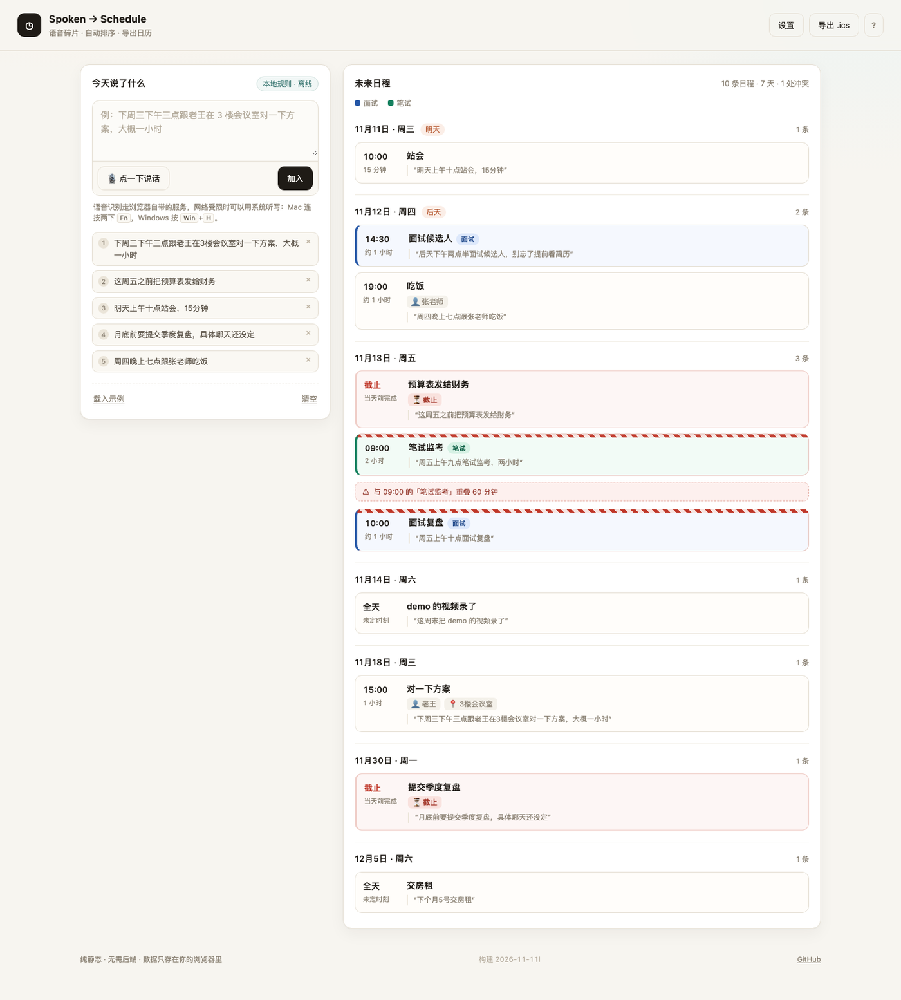

# Spoken → Schedule

**一天里随口说出的碎片语音，自动整理成排好序的时间轴，一键导出到系统日历。**

纯静态站点：没有后端、没有构建步骤、没有账号体系。数据只留在你自己的浏览器里。

<p>
  <a href="https://Seoyo-Yam-RUBY.github.io/spoken-to-schedule/"></a>
  <a href="LICENSE"></a>
  
  
</p>

👉 **在线体验**：`https://Seoyo-Yam-RUBY.github.io/spoken-to-schedule/` ｜ **带示例数据**：`https://Seoyo-Yam-RUBY.github.io/spoken-to-schedule/?demo=1`



---

## 一键部署

不想看代码，直接点：

[](https://vercel.com/new/clone?repository-url=https://github.com/Seoyo-Yam-RUBY/spoken-to-schedule)
[](https://app.netlify.com/start/deploy?repository=https://github.com/Seoyo-Yam-RUBY/spoken-to-schedule)

两个按钮都是纯静态托管，不需要填任何环境变量，几十秒就能拿到自己的地址。

### 部署到 GitHub Pages（本仓库的默认方式）

1. 打开仓库 **Settings → Pages**
2. **Source** 选 `Deploy from a branch`，分支选 `main`，目录选 `/ (root)`
3. 保存，等 1 分钟，访问 `https://Seoyo-Yam-RUBY.github.io/spoken-to-schedule/`

没有构建步骤，所以也不需要 Actions，push 即生效。

---

## 为什么做这个

开会、通勤、走路的时候，脑子里的待办是**语音碎片**：一句「下周三之前把方案给老王」，一句「周五下午三点跟设计对一下」。

这些碎片要落到日程里，得先记下来、再打开日历、再一条条手填——**中间那一步通常就不做了**。

所以这个工具只做一件事：把碎片直接变成时间轴。

## 它做什么

| 步骤 | 说明 |
|---|---|
| 说出来 | 点一下麦克风，或用键盘输入，一次一条，随时补 |
| 自动抽取 | 从口语里抽出：事件、日期、时刻、时长、人物、地点 |
| 排上时间轴 | 按日期分组、按时间排序；没日期的自动归到「待定」 |
| 标出问题 | 时间冲突用卡片顶部斜纹 + 卡间提示行（不改变底色）；疑似同一件事标黄 |
| 就地编辑 | 点「编辑」可改标题、时间、地点、人物、类别与类型，改完立即重排 |
| 一句话多件事 | 按标点切句并自动归并，例如「周六去天河区面试下午4点，笔试截止周日晚上8点」拆成两条 |
| 分类着色 | 面试→蓝色，笔试→绿色，截止→红色（优先级最高，冲突时仍保留红条），左侧色条 + 标签 + 图例 |
| 导出 | 生成 `.ics`（带稳定 UID、`SEQUENCE`、`LAST-MODIFIED`），双击导入系统日历 |

## 冲突怎么表示

三个通道各管一件事，互不覆盖：

| 通道 | 表达什么 | 具体表现 |
|---|---|---|
| 颜色 | 这是什么事 | 面试蓝、笔试绿、截止红 |
| 纹理 | 这里有问题 | 卡片顶部 5px 红白斜纹带 |
| 文字 | 和谁冲突、重多久 | 两条重叠事件之间插入「⚠ 与 09:00 的「笔试监考」重叠 60 分钟」 |

之所以这么分：截止任务本身就要占用红色，如果冲突也改底色，两个信号会互相冲淡。把冲突从颜色通道挪到纹理和文字上，截止的红色才能完整保留，冲突也不会被忽略。

想看效果，直接打开 `?demo=1`——周五那天有一条面试和一条笔试重叠 60 分钟。

## 两条抽取通道

| 引擎 | 配置 | 特点 |
|---|---|---|
| **本地规则**（默认） | 零配置、离线可用 | 覆盖常见中文时间表达：明天/后天/下周三/月底/下月 5 号、上午十点/下午三点半、大概一小时 |
| **大模型** | 设置里填 API Key | 对模糊表达更准；支持 Google Gemini 与任意 OpenAI 兼容接口（DeepSeek 等） |

> 公开演示默认走本地规则，所以**不需要任何 Key 也能完整体验**。Key 只存在你的 `localStorage`，不会上传到任何服务器。

## 语音是怎么工作的

点麦克风有两种模式，自动切换：

| 模式 | 触发条件 | 说明 |
|---|---|---|
| 浏览器识别 | 默认 | Web Speech API，**需要能访问 Google 的语音服务**；国内网络通常连不上，会直接提示原因 |
| 录音转写 | 设置里填了「转写 Key」 | 浏览器录音（MediaRecorder）→ POST 到你指定的 OpenAI 兼容 `/audio/transcriptions`，默认示例是硅基流动的 `SenseVoiceSmall` |

两条路都走不通时，还有第三条兜底：用系统听写直接往输入框里打字（Mac 连按两下 `Fn`，Windows 按 `Win`+`H`）。

## 数据契约

每条日程长这样，是整条链路唯一的中间格式：

```json
{
  "id": "a1b2c3d",
  "title": "对方案",
  "date": "2026-11-18",
  "start": "15:00",
  "duration": 60,
  "people": ["老王"],
  "place": "3楼会议室",
  "kind": "event",
  "confidence": 0.92,
  "source": "下周三下午三点跟老王在3楼会议室对一下方案，大概一小时",
  "engine": "local"
}
```

排序、冲突检测、去重提示、`.ics` 导出，全部只是对这张表的运算——**抽取准不准，决定了整个工具好不好用**。

## 目录结构

```
.
├── index.html          # 全部界面
├── assets/
│   ├── style.css       # 样式
│   └── app.js          # 抽取 + 排序 + 冲突 + 导出（约 500 行，无依赖）
├── README.md
└── LICENSE
```

## 本地跑

不需要 Node，也不需要装依赖：

```bash
python3 -m http.server 8000
# 打开 http://localhost:8000
```

或者直接双击 `index.html` 也能用（麦克风权限在 `file://` 下可能被禁用，建议用上面的方式）。

## 已知边界

- 相对时间依赖**运行时的系统时间**，跨时区使用会把日期算错
- 「看情况再说」「有空的时候」这类表达，会落到「待定」而不是猜一个时间
- 冲突只标红，不给调整建议
- 同一件事换个说法说两遍，只会标黄，不会自动合并
- 语音识别默认走浏览器的 Web Speech API，Safari / 移动端支持不完整；配了转写 Key 则改为录音上传

### 导出的边界

导出是**快照式**的：每次导出的都是当前全部日程，不是增量。文件里带了稳定 `UID`、`SEQUENCE` 和 `LAST-MODIFIED`，支持的客户端会把「同一条事件的新版本」覆盖到旧版本上。

但要清楚它做不到什么：

| 情况 | 结果 |
|---|---|
| 改了一条事件，重新导出并导入 | Apple 日历 / Outlook 通常会替换；Google 日历常常还是新增 |
| 两件不同的事 | `UID` 不同，**永远不会合并** |
| 清空数据 / 换浏览器 / 换设备后重录同一件事 | `UID` 会重新生成，客户端视为两件不同的事 |
| 同一份文件导进两个不同日历 | 两条独立条目，任何字段都管不了 |

所以推荐的做法是：**单独建一个「语音日程」日历承载导入**，需要重导时整个日历删掉再导。这条不依赖任何客户端行为，比指望 `SEQUENCE` 可靠。


### 导入手机日历（iOS）

页面右上角的 **?** 按钮里有同样的步骤。核心是「专用日历 + 整块替换」：

1. 日历 App → 底部「日历」→ 添加日历，命名「语音日程」
2. **设置 → 日历 → 默认日历 → 选「语音日程」**（导入的事件进默认日历，不改这步等于白建）
3. 导入下载的 `.ics`
4. 重导前：日历 App → 「语音日程」右侧 ⓘ → 删除日历 → 删除所有事件
5. 再导入新的文件

这样无论导过几次都不会累积重复，也不依赖任何客户端去重逻辑。


## Roadmap

- [ ] 冲突时给一个「挪到下一个空档」的建议
- [ ] 一个月的日程密度热力图
- [ ] 导出为 Markdown 待办清单
- [ ] 端上做一层简单的端侧缓存，支持离线

## AI 使用记录

> 这一节记录「用 AI 完成开发」的过程，方便复现，也方便别人判断哪些部分是工具做的、哪些是判断。

| 环节 | 工具 | 做法 |
|---|---|---|
| 需求收敛 | 对话式梳理 | 先定数据契约，再定界面，避免边写边改结构 |
| 骨架与界面 | AI 生成 + 人工调 | 一次性生成静态骨架，再按真实数据调排版 |
| 规则抽取 | AI 起草 + 人工补边界 | 生成正则后手工补了「月底」「周末」「半小时」等漏掉的说法 |
| 模型抽取 | AI 生成 | 固定 JSON schema + 低 temperature，输出不稳定时回退规则 |
| 调试 | 人工为主 | 用真实口语句子逐条比对，记录错误类型再改 |

## License

MIT
